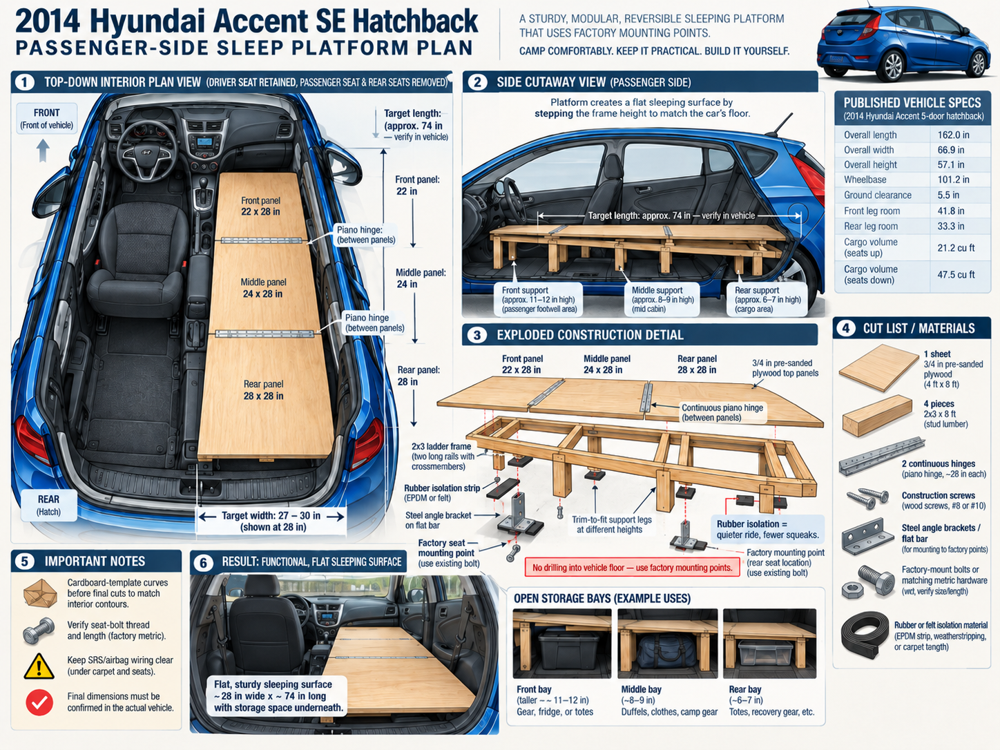
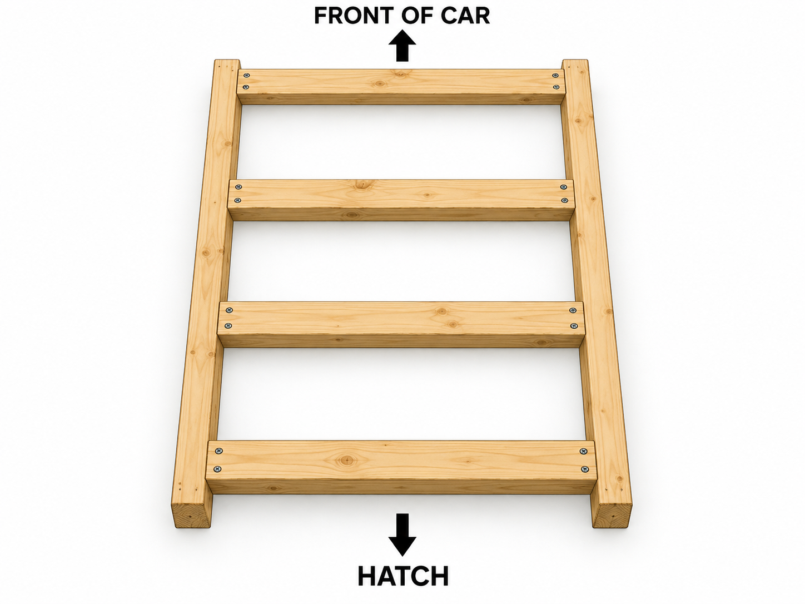
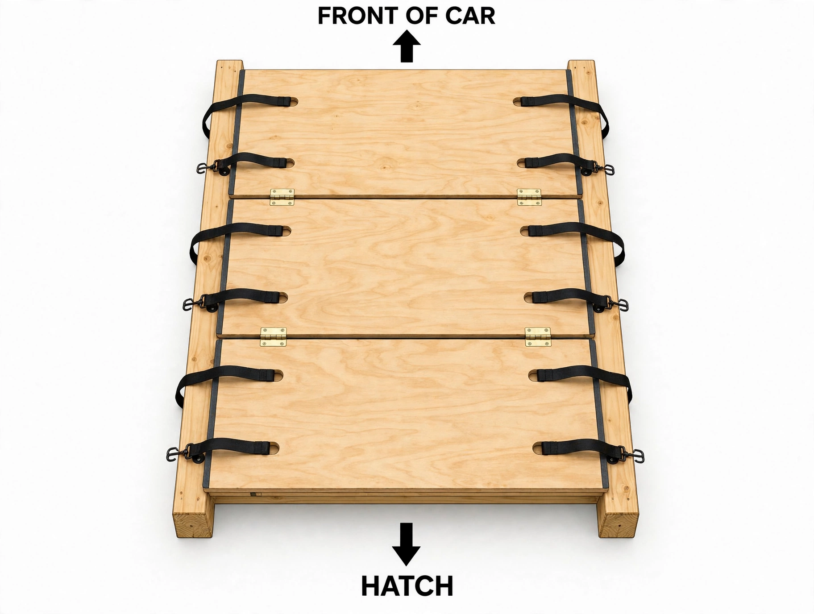

# 2014 Hyundai Accent SE Hatchback
## Passenger-Side Modular Sleeping Platform Build Plan

**Project status:** Detailed concept / pre-build specification  
**Vehicle:** 2014 Hyundai Accent SE 5-door hatchback  
**Store used for current pricing:** Menards, 3200 N Wayne St, Angola, IN 46703  
**Price research date:** October 26, 2026  
**Design priority:** Strong, quiet, reversible, inexpensive, easy to repair, and functional rather than decorative.

---

## 1. Project Goal

Build a permanent-quality but fully removable **one-person passenger-side sleeping platform** in a 2014 Hyundai Accent SE hatchback after removing:

- the front passenger seat
- the rear seat assembly

The driver's seat remains installed and usable.

The platform should:

- create a flat sleeping surface from the former passenger-seat area to the hatch
- preserve as much driver-side interior space as practical
- provide open storage underneath
- use the vehicle's existing factory seat mounting locations rather than drilling new holes through the vehicle floor
- be built from pre-sanded plywood and ordinary dimensional lumber
- use hinged access sections
- use rubber isolation anywhere practical between the platform and vehicle structure/interior to minimize squeaks, rattles, and abrasion
- remain removable so the car can later be returned toward stock configuration
- prioritize function, strength, silence, and serviceability over appearance

---

# 2. Published Vehicle Data

The U.S.-market 2014 Hyundai Accent 5-door hatchback has the following published dimensions:

| Specification | Published value |
|---|---:|
| Overall length | 162.0 in |
| Overall width, excluding mirrors | 66.9 in |
| Overall height | 57.1 in |
| Wheelbase | 101.2 in |
| Ground clearance | 5.5 in |
| Front leg room | 41.8 in |
| Rear leg room | 33.3 in |
| Front shoulder room | 53.7 in |
| Rear shoulder room | 53.4 in |
| Front hip room | 51.3 in |
| Rear hip room | 47.2 in |
| Cargo volume, rear seats up | 21.2 cu ft |
| Cargo volume, rear seats folded | 47.5 cu ft |
| Approx. maximum payload, depending on configuration | roughly 994-1,060 lb published by major specification databases |

Hyundai's U.S. brochure confirms that the 2014 5-door has **47.5 cu ft of cargo space with the rear seats folded** and uses a 60/40 folding rear seat.

### Important limitation

Hyundai's public brochure/specification data does **not** provide the exact linear dimensions needed to fabricate a custom sleeping platform after the passenger and rear seats are physically removed.

Therefore:

> **All platform width, length, support-height, contour, and factory-mount geometry values below are preliminary design targets until measured directly in the actual car.**

The design has intentionally been made easy to trim and adjust during fabrication.

---

# 3. Baseline Platform Geometry

## Target finished size

The current concept uses:

- **Target width:** 27-30 in
- **Nominal design width:** 28 in
- **Target overall length:** approximately 74 in
- **Nominal top thickness:** 3/4 in plywood
- **Driver side:** driver seat remains installed
- **Passenger side:** entire platform

A 74-inch sleeping length is the current target, but the vehicle should be measured after seat removal before plywood is cut.

## Preliminary three-section top

| Section | Preliminary size |
|---|---:|
| Front panel | 22 x 28 in |
| Middle panel | 24 x 28 in |
| Rear panel | 28 x 28 in |
| Total nominal length | 74 in |
| Nominal width | 28 in |

These three pieces require only a **28 x 74 inch strip** of the plywood sheet, leaving substantial scrap for blocking, templates, reinforcement pieces, or later additions.

---

# 4. Recommended Plywood

## Primary choice

**3/4 x 4 x 8 Sanded Utility Plywood**

Current Menards listing:

- actual thickness: approximately **0.70 in**
- width: 48 in
- length: approximately 95-7/8 in
- Menards SKU: **1252051**
- current listed everyday price found on October 26, 2026: **$65.16**

This is preferred over OSB because:

- smoother sleeping-platform surface
- cleaner edges
- better screw holding
- easier hinge installation
- easier to seal
- less prone to edge crumbling
- better long-term choice in a humid vehicle interior

Marine plywood is not necessary for this indoor application and currently costs roughly twice as much.

---

# 5. Frame Design

## Material

Use **untreated 2 x 3 construction/framing lumber**.

Menards currently lists:

- **2 x 3 x 8 ft Stud or Better Construction/Framing Lumber**
- SKU **1021020**
- current listed price: **$3.48 each**

### Quantity

The original estimate was four pieces.

For the actual build, **five 8-foot pieces are recommended**.

Why five:

- two long longitudinal rails
- multiple crossmembers
- stepped support legs
- extra blocking around mounting points
- allowance for imperfect cuts
- allowance for one warped or otherwise poor piece
- enough scrap for later reinforcement

Five boards still add very little cost.

## Ladder-frame structure

The basic underframe should use:

- two longitudinal 2x3 rails
- crossmembers between them
- multiple vertical or shaped support blocks
- extra blocking near factory anchoring brackets

A concept layout is:



The frame should not be treated as one uniform-height rectangular box.

The car floor changes elevation from front to rear, so the frame should use **trim-to-fit stepped supports** to produce one flat top plane.

---

# 6. Preliminary Support Heights

The illustration currently depicts approximately:

| Area | Illustrative starting estimate |
|---|---:|
| Front/passenger-footwell area | 11-12 in |
| Mid-cabin area | 8-9 in |
| Rear cargo area | 6-7 in |

These values are **NOT final cut dimensions**.

They are simply design estimates representing the concept that the front support will probably need to be taller than the rear support.

### Correct fabrication method

After all intended seats are removed:

1. Park the car on level ground.
2. Establish the desired finished top plane.
3. Measure from the vehicle floor/body mounting surfaces up to that plane at several locations.
4. Cut each support individually.
5. Test fit.
6. Shim or trim until the plywood top is genuinely level.
7. Only then permanently screw the wooden support structure together.

---

# 7. Hinged Access Design

The platform should have **three top sections** so storage can be reached without removing the entire platform.

## Continuous hinges

The preferred hardware is continuous/piano hinge rather than several small furniture hinges.

Current Menards listing:

**National Hardware 1-1/16 x 48 in Brass Continuous Door Hinge**

- model: N148-353
- SKU: **2253787**
- everyday price: **$13.22 each**
- quantity: **2**

Two 48-inch hinges provide 96 inches of hinge stock, enough to cut sections for this project.

### Two viable hinge layouts

#### Layout A - current illustration concept

The three panels are connected to one another across their transverse joints.

Advantages:

- simple construction
- panels stay aligned
- entire top behaves as one unit
- inexpensive

Disadvantages:

- accessing one bay may require folding another section
- mattress/bedding may need to be moved

#### Layout B - recommended final refinement if clearance allows

Make each of the three top panels an **independent hinged lid attached to one longitudinal frame rail**.

Advantages:

- each storage bay opens independently
- easier access while living out of the car
- less accordion-fold behavior

Disadvantages:

- hinge orientation must be tested against door trim, center console, driver seat, mattress, and roof clearance

### Final decision

Do not drill hinge holes until the bare platform frame is test-fitted in the car.

---

# 8. Rubber Isolation and Anti-Rattle Design

This is an important part of the build.

A rigid wooden structure inside a unibody hatchback can develop:

- squeaks
- tapping noises
- plastic-trim rubbing
- bracket chatter
- vibration noise

Use rubber, dense felt, or automotive weatherseal wherever practical between the platform and vehicle surfaces.

## Current recommended material

Menards currently lists:

**19/32 in wide x 5/16 in high x 10 ft Self-Adhesive Auto and Marine Rubber Weatherseal - Black**

- SKU **4366396**
- current listed price: **$10.34**

Use strips:

- beneath wood supports touching painted metal
- between steel adapters and surfaces where appropriate
- where wood could rub plastic trim
- at small preload/contact points used to eliminate vibration

Do **not** put soft rubber in a location where it would prevent a safety-critical mounting bolt from being properly tightened.

The rubber is for isolation and abrasion control, not for making a structural fastener spongy.

---

# 9. Factory-Mount Anchoring Plan

## Core rule

> **Do not drill new holes through the vehicle floor.**

The preferred design uses mounting locations exposed when the passenger and rear seats are removed.

The platform should be mechanically restrained so it cannot become a heavy projectile during braking or a crash.

### Proposed system

```text
factory threaded seat/body mounting point
            |
       factory bolt
            |
       steel adapter
            |
      wooden blocking
            |
       2x3 platform
```

Possible steel adapter materials:

- steel angle
- steel flat bar
- stout structural corner bracket

## Steel stock budget item

A suitable starting stock currently listed at Menards is:

**SteelWorks 1-1/2 x 48 in Steel Angle**

- model 11710
- SKU **2278759**
- current listed everyday price: **$17.99**

A 48-inch piece can be cut into multiple short adapters if its thickness and geometry are suitable after the seats are removed.

### Factory bolt warning

The precise thread diameter, pitch, length, shoulder configuration, and required engagement must be verified from:

- the original removed Hyundai hardware
- direct measurement
- proper Hyundai service information if replacement bolts are needed

Do **not** assume the thread size from the concept drawing.

Whenever possible, reuse the original factory fastener at its original threaded body location if its length and adapter geometry remain appropriate.

---

# 10. SRS / Airbag / Passenger-Seat Safety

The 2014 Accent uses an advanced supplemental restraint system and the front passenger seat incorporates an occupant detection/classification system.

Removing the passenger seat therefore is **not only a woodworking operation**.

Published Hyundai information confirms:

- front and side airbags
- an occupant classification/detection system associated with the passenger seat
- SRS wiring and connectors under/around the seat

Service information for this generation indicates the SRS disable procedure includes:

1. ignition OFF
2. disconnect the negative battery cable
3. wait at least three minutes before working on SRS components/connectors

### Rules for this project

- Never disconnect yellow SRS connectors while the system is energized.
- Never probe airbag connectors with ordinary test equipment.
- Never use homemade resistors or bypass devices to trick the SRS.
- Keep all wiring protected from the platform frame.
- Do not trap wiring beneath wood, steel brackets, or mounting bolts.
- If an SRS warning remains after the passenger seat is removed, have the system evaluated using proper Hyundai-compatible diagnostic equipment.
- The platform must never interfere with the driver seat, driver seat belt, pedals, steering, parking brake, shifter, or driver-side airbag operation.

This document does not attempt to redesign the vehicle's restraint system.

---

# 11. Current Menards Material / Price List

**Research date:** October 26, 2026  
**Store:** Menards, Angola, Indiana  
**Address:** 3200 N Wayne St, Angola, IN 46703

Prices below are current web-listed prices found during research. Local shelf inventory and exact local pricing should be confirmed before purchase.

| Item | Qty | Current price each | Extended |
|---|---:|---:|---:|
| 3/4 x 4 x 8 Sanded Utility Plywood, SKU 1252051 | 1 | $65.16 | $65.16 |
| 2 x 3 x 8 Stud or Better framing lumber, SKU 1021020 | 5 | $3.48 | $17.40 |
| National Hardware 1-1/16 x 48 continuous hinge, SKU 2253787 | 2 | $13.22 | $26.44 |
| SPAX #8 x 2-1/2 construction screws, 1 lb box, SKU 2302163 | 1 | $11.29 | $11.29 |
| Grip Fast Premium #8 x 1-1/4 star-drive construction screws, 1 lb box, SKU 2302201 | 1 | $8.99 | $8.99 |
| Auto/marine rubber weatherseal, 10 ft, SKU 4366396 | 1 | $10.34 | $10.34 |
| SteelWorks 1-1/2 x 48 steel angle, SKU 2278759 | 1 | $17.99 | $17.99 |
| Matching automotive metric fasteners / washers / misc. anchoring hardware | allowance | — | $15.00 |
| **Estimated material subtotal** |  |  | **$172.61** |

### Indiana sales tax

Indiana's state sales tax is currently **7%**.

Estimated tax on the above subtotal:

**$12.08**

### Estimated checkout total before any rebate credit

# **$184.69**

This is a realistic target budget for the quality version of the platform, assuming the project does not require unusual custom automotive brackets.

---

# 12. Current Menards 11% Rebate Context

Current advertising found during the October 26, 2026 research shows an **11% rebate promotion running through approximately November 1, 2026**.

Menards rebates are generally **not an instant checkout discount**. They are typically issued as future merchandise credit.

If the entire estimated $172.61 material subtotal qualifies:

- estimated 11% rebate value: **about $18.99**
- checkout amount with estimated Indiana sales tax: **about $184.69**
- effective cost after later rebate value: **about $165.71**

Always confirm the active rebate and item eligibility at the time of purchase.

---

# 13. Optional Moisture-Protective Finish

A clear finish is **not necessary for appearance**, but it is worthwhile for function.

A vehicle interior experiences:

- condensation
- humidity
- temperature changes
- wet shoes
- damp camping gear
- occasional spills

A clear water-based finish can make the plywood easier to clean and more resistant to moisture absorption.

One current example:

**Minwax Polycrylic Interior Water-Based Clear Protective Wood Finish - 1 qt**

- SKU **5558047**
- regular listed price: **$19.99**

With this added:

- estimated pre-tax project subtotal: **$192.60**
- estimated 7% tax: **$13.48**
- estimated checkout total: **$206.08**

If a current 11% rebate applies to the whole purchase, the effective cost after rebate value would be approximately **$184.90**.

### Recommended finish approach

No stain is needed.

Use:

- clear matte/flat or satin water-based finish
- coat the top
- coat exposed edges especially well
- ideally coat the underside too
- allow it to cure fully before installing it in the car

That keeps the project plain-looking but materially more durable.

---

# 14. Cutting Plan

A single 4 x 8 plywood sheet is more than sufficient.

## Initial plywood cuts

Do **not** immediately cut exact contour shapes.

First cut oversize rectangular blanks approximately:

- 22 x 28 in
- 24 x 28 in
- 28 x 28 in

Then test-fit and trim.

### Better method

1. Remove seats.
2. Make cardboard templates of:
   - side trim
   - center-console interference
   - B-pillar/C-pillar contours if relevant
   - hatch trim
   - wheel-well intrusion if relevant
3. Transfer the templates to the plywood.
4. Keep at least a small clearance from plastic trim.
5. Use rubber/felt where a close fit is desirable.
6. Round sharp outer corners.

---

# 15. Frame Cut Strategy

Do not pre-cut every leg from the drawing.

Recommended sequence:

### Longitudinal rails

Start with two rails close to the final platform length.

### Crossmembers

Install crossmembers:

- near the front edge
- near each hinge/panel boundary
- near the rear edge
- at mounting bracket locations
- anywhere the plywood needs additional support

### Vertical supports

Cut them only after the rails are sitting inside the bare vehicle and the top plane has been established.

### Maximum span philosophy

The 3/4-inch plywood is stiff, but the goal is to avoid noticeable flex when climbing into bed.

Crossmember spacing around **16-24 inches or less** is a practical target, with extra reinforcement around hinge lines and high-load areas.

---

# 16. Open Storage Layout

The platform should remain largely open underneath rather than becoming a heavy enclosed cabinet.

Possible storage zoning:

### Front bay

Likely tallest bay.

Good for:

- taller gear
- electrical equipment
- small cooler/fridge if dimensions fit
- bags

### Middle bay

Good for:

- clothing
- duffels
- electronics
- general camp equipment

### Rear bay

Good for items that should be immediately accessible from the hatch:

- tools
- recovery equipment
- food tote
- cooking gear
- frequently used supplies

Avoid permanent walls unless they are structurally needed.

Open bays:

- reduce weight
- improve ventilation
- make odd-shaped gear easier to fit
- simplify repairs

---

# 17. Functional Details Worth Adding

## Finger holes instead of handles

A 1-1/4 to 1-1/2 inch finger hole in each lid can eliminate protruding handles.

Benefits:

- essentially free
- no handle to catch bedding
- no extra hardware
- easy to use

Sand the hole edges smooth.

## Soft stops

Small rubber bumpers can prevent lids from rattling against the frame.

## Captive bedding

The platform itself does not need decorative edging. A mattress/pad will cover most of it.

## Removability

Design the system so the sequence is approximately:

1. remove mattress/gear
2. remove several factory-mount bolts
3. unplug or undo no permanent body modifications
4. lift the platform out as one unit or a few modules

---

# 18. Tools Likely Needed

The assumption is that most or all are already owned.

Typical tools:

- tape measure
- carpenter square
- straightedge
- pencil/marker
- circular saw, track saw, or jigsaw
- jigsaw for interior contours
- drill/driver
- drill bits
- metal drill bits for brackets if needed
- countersink bit optional
- socket set
- metric sockets
- wrenches
- clamps
- sanding block or orbital sander
- utility knife/scissors for rubber strip
- file/deburring tool for cut steel
- eye protection
- hearing protection

Useful but not mandatory:

- level
- digital angle gauge
- step drill bit
- rivnut tools are **not required** for the current no-new-hole design

---

# 19. Recommended Build Order

## Phase 1 - Strip and inspect

1. Photograph the complete interior.
2. Photograph all passenger and rear seat mount locations before removal.
3. Remove the intended seats using the correct SRS precautions.
4. Retain and label all factory bolts and trim pieces.
5. Vacuum and clean the exposed floor.
6. Inspect wiring routes and factory mounting points.

## Phase 2 - Measure

Measure:

- maximum usable platform length
- practical sleeping width
- width at front, middle, and hatch
- center-console interference
- door-closing clearance
- hatch clearance
- floor-to-target-plane height at multiple points
- locations of every factory threaded anchor
- distance from platform edge to driver controls
- mattress thickness versus remaining headroom

Record all measurements before buying custom automotive fasteners.

## Phase 3 - Cardboard prototype

Build a full top outline from cardboard.

Confirm:

- hatch closes
- doors close
- driver seat functions
- shifter/parking brake remain accessible
- no trim is crushed
- sleeping length is adequate

## Phase 4 - Frame

1. Cut longitudinal rails.
2. Add crossmembers.
3. Add rough supports.
4. Place frame in car.
5. Trim supports until level.
6. Add steel anchoring adapters.
7. Add rubber isolation.

## Phase 5 - Plywood top

1. Cut rectangular blanks.
2. Transfer cardboard contours.
3. Test-fit each panel.
4. Round/sand all edges.
5. Drill finger pulls if desired.
6. Seal the wood if using clear finish.

## Phase 6 - Hinges

1. Test desired opening direction.
2. Cut continuous hinge sections.
3. Pre-drill screw holes.
4. Install hinges.
5. Confirm full travel without hitting trim or the driver seat.

## Phase 7 - Final anchoring

1. Fit steel adapters to verified factory locations.
2. Protect nearby wiring.
3. Tighten mounting hardware appropriately.
4. Confirm no bracket can rotate into wiring or trim.
5. Test the structure by loading it gradually.

## Phase 8 - Road test

Drive on:

- smooth pavement
- rough pavement
- turns
- braking events

Listen for:

- squeaks
- knocks
- rattles
- trim rubbing

Add or reposition rubber isolation as needed.

---

# 20. Things Not to Do

- Do not drill blindly through the vehicle floor.
- Do not use pressure-treated lumber inside the passenger compartment.
- Do not assume factory seat-bolt thread sizes.
- Do not trap SRS wiring beneath the frame.
- Do not bypass the passenger-seat occupancy system with a resistor hack.
- Do not build the frame so wide that it interferes with the driver seat or controls.
- Do not permanently glue the platform to interior trim.
- Do not make the platform much heavier than necessary.
- Do not rely on friction alone to hold the platform during a crash.
- Do not make final plywood contour cuts from internet measurements alone.

---

# 21. Expected Finished Character

The intended result is deliberately simple:

- 28-ish inches wide
- roughly 74 inches long
- flat
- pre-sanded plywood
- exposed practical framing
- continuous hinges
- open storage
- rubber-isolated contact points
- bolted to existing vehicle mounting locations
- no decorative cabinetry
- no unnecessary weight

The goal is a **quiet little piece of infrastructure**, not furniture.

Once a mattress is on top, almost none of the woodworking needs to be visually impressive.

---

# 22. Budget Summary

## Quality functional build

**Expected checkout cost:** approximately **$185**

## With clear protective finish

**Expected checkout cost:** approximately **$206**

## Effective cost if the current 11% Menards rebate applies

Approximately:

- **$166** without clear finish
- **$185** with clear finish

The largest uncertainties are:

- final automotive mounting hardware
- whether one steel adapter bar/angle is enough
- whether extra rubber isolation is desired
- whether the final hinge arrangement needs extra hardware

A sensible real-world cash budget is therefore:

# **$200-$225 available at the store**

That provides enough margin to build it correctly rather than compromising over a missing bracket, bolt, or strip of rubber.

---

# 23. Current Source Links

## Hyundai / vehicle specifications

- 2014 Hyundai Accent U.S. brochure PDF:  
  https://cdn.dealereprocess.org/cdn/brochures/hyundai/2014-accent.pdf

- 2014 Hyundai Accent hatchback specifications, Car and Driver:  
  https://www.caranddriver.com/hyundai/accent/specs/2014/hyundai_accent_hyundai-accent-hatchback_2014

- 2014 Hyundai Accent hatchback specifications, Edmunds:  
  https://www.edmunds.com/hyundai/accent/2014/hatchback/features-specs/

## SRS / service references

- 2014 Hyundai Accent OEM-restraint procedure summary, I-CAR:  
  https://rts.i-car.com/srs-8002.html

- Hyundai Accent RB front seat repair/service information:  
  https://www.hamanual.com/front_seat_repair_procedures-1226.html

- 2014 Accent owner manual reference:  
  https://www.dezosmanuals.com/wp-content/uploads/2021/07/2014-Hyundai-Accent-OM.pdf

## Menards current material references

- Sanded Utility Plywood, SKU 1252051:  
  https://www.menards.com/main/building-materials/panel-products/plywood-sheathing/3-4-x-4-x-8-sande-plywood/plytsan180bc0c8/p-1523255743593.htm

- Menards dimensional lumber category, including 2 x 3 x 8 SKU 1021020:  
  https://www2.menards.com/main/building-materials/lumber-boards/dimensional-lumber/c-13125.htm

- National Hardware 48-inch continuous hinge, SKU 2253787:  
  https://www.menards.com/main/hardware/door-window-hardware/door-hinges/national-hardware-reg-1-1-16-x-48-brass-continuous-door-hinge/n148-353/p-1444448891756-c-9687.htm

- SPAX #8 x 2-1/2 construction screws, SKU 2302163:  
  https://www.menards.com/main/hardware/fasteners-connectors/screws/deck-screws/spax-reg-8-x-2-1-2-t-star-drive-hcr-x-exterior-coated-wafer-head-multi-purpose-construction-screw-1-lb-box/4281670400604/p-1561357833269-c-8929.htm

- Grip Fast Premium #8 x 1-1/4 construction screws, SKU 2302201:  
  https://www.menards.com/main/hardware/fasteners-connectors/screws/wood-screws/grip-fast-reg-premium-8-x-1-1-4-star-drive-steel-yellow-zinc-flat-head-interior-construction-screw-1-lb-box/gfp1141yz1/p-1642874262698634-c-8940.htm

- Weather stripping category / auto-and-marine rubber seal SKU 4366396:  
  https://www.menards.com/main/hardware/weather-stripping/c-3624.htm

- SteelWorks 1-1/2 x 48 steel angle, SKU 2278759:  
  https://www.menards.com/main/hardware/sheet-metal-rods/steelworks-1-1-2-x-48-steel-angle/11710/p-1444432408839-c-9215.htm

- Minwax Polycrylic 1 qt, SKU 5558047:  
  https://www.menards.com/main/paint/interior-paint-stain/polyurethane-clear-protective-finishes/water-based-polyurethane/minwax-reg-polycrylic-reg-interior-water-base-clear-protective-wood-finish/611114444/p-3289655538931721-c-7967.htm

## Tax

- Indiana Department of Revenue - sales tax information:  
  https://www.in.gov/dor/i-am-a/business-corp/business-faq/

---

# 24. Final Pre-Purchase Measurement Sheet

Fill this out after the seats are removed.

```text
PASSENGER-SIDE PLATFORM MEASUREMENT SHEET

Maximum usable overall length: ______ in

Usable width:
  Front:   ______ in
  Middle:  ______ in
  Rear:    ______ in

Desired finished platform width: ______ in

Floor-to-finished-platform height:
  Front outer:   ______ in
  Front inner:   ______ in
  Mid outer:     ______ in
  Mid inner:     ______ in
  Rear outer:    ______ in
  Rear inner:    ______ in

Factory mounting points:
  Front #1: _______________________________
  Front #2: _______________________________
  Rear #1:  _______________________________
  Rear #2:  _______________________________
  Additional: _____________________________

Factory bolt markings / dimensions:
  _________________________________________
  _________________________________________

Center-console clearance: ______ in

Passenger-door clearance: ______ in

Hatch clearance: ______ in

Platform-to-roof/headliner height:
  Front: ______ in
  Mid:   ______ in
  Rear:  ______ in

Mattress/pad thickness: ______ in

Remaining sleeping headroom with mattress: ______ in
```

---

## Bottom Line

The current design is a **strong, modular, rubber-isolated, three-section sleeping platform** using one sheet of sanded 3/4-inch plywood, five 2x3s, continuous hinges, steel adapters, and the Accent's existing seat/body mounting locations.

The design is intentionally conservative about dimensions that cannot be verified from published vehicle data.

Once the seats are physically out and the measurement sheet is completed, this concept can be converted into an exact final cut list with essentially no guesswork.

---

# Improved Removable Hinged-Top Retention Design
## Addendum for the 2014 Hyundai Accent SE Passenger-Side Sleeping Platform

This section supersedes the earlier top-retention concept wherever the two conflict.

The purpose of this refinement is to keep the sleeping platform:

- quiet
- strong
- fully supported
- easy to open for normal storage access
- easy to remove for deep storage access
- securely retained while driving
- simple to build and repair
- free of straps running across the sleeping surface

---

# 1. Core Design

The sleeping platform consists of two major assemblies:

1. **A rigid 2x3 wooden frame**
2. **A full-width plywood top made from multiple hinged sections**

The wooden frame remains mechanically secured to the Hyundai's existing factory seat/body mounting locations.

The plywood top rests on the frame but is **not permanently screwed to it**.

Instead, the top is held firmly to the frame by multiple **heavy-duty cam-lock cargo straps positioned only along the two long side edges of the platform**.

The straps do **not** run across the width of the plywood.

---

# 2. Full-Width Plywood Top

The plywood top should be approximately the same finished width as the outside width of the platform frame.

In other words:

> **The plywood covers the complete frame width, including both longitudinal side rails.**

The preliminary target remains approximately:

- **Width:** about 28 inches
- **Overall length:** about 74 inches

Final dimensions must still be measured in the actual vehicle after the passenger and rear seats are removed.

The top uses:

- 3/4-inch pre-sanded plywood
- multiple sections
- continuous/piano hinges between sections

A practical preliminary section layout remains:

- front section
- middle section
- rear section

The exact panel lengths can be adjusted after the interior is measured.

---

# 3. Hinged Access

The plywood sections remain connected by strong continuous hinges.

This provides the **normal everyday access method**.

Instead of removing the entire top whenever storage is needed:

1. release any side straps that prevent the desired section from opening
2. lift/fold the appropriate hinged section
3. access the storage bay beneath it
4. close the plywood section
5. re-secure the appropriate cam-lock straps

This allows quick access to gear without dismantling the platform.

---

# 4. Deep-Access Removal

For occasions when much greater access is needed, the entire hinged plywood-top assembly can be released from the frame.

The process is:

1. release all cam-lock cargo straps
2. free the straps from their plywood holes/frame loops as necessary
3. fold the hinged plywood top into a manageable configuration if helpful
4. lift the entire plywood-top assembly away from the frame
5. gain completely unobstructed access to the open frame and storage area below

The frame itself remains anchored to the car.

This gives the platform **two distinct access modes**:

### Everyday access

Use the hinged plywood sections.

### Deep access

Release the side-edge cam straps and remove the hinged top assembly.

---

# 5. Rubber Isolation Layer

A thin rubber isolation layer should be placed between the wooden frame and the plywood top.

This is an important part of the design.

Recommended material:

- EPDM rubber
- neoprene rubber
- dense automotive rubber strip
- other durable noncompressible anti-rattle material

Recommended thickness:

- approximately **1/16 inch**
- up to approximately **1/8 inch** if the material is fairly firm

Avoid excessively thick or soft foam.

The top should feel solid rather than springy.

---

# 6. Rubber Placement

Rubber should be placed along the upper surfaces where the plywood actually bears against the wooden frame.

This should normally include:

- top of the left longitudinal 2x3 side rail
- top of the right longitudinal 2x3 side rail
- top surfaces of supporting crossmembers where appropriate

The rubber serves several purposes:

- prevents wood-on-wood squeaking
- reduces vibration
- reduces rattling
- protects the plywood underside
- protects the frame
- slightly increases friction between the plywood and frame
- improves the solid feel of the finished platform

The rubber is **not** the structural retention system.

The cam-lock cargo straps provide the hold-down force.

---

# 7. Side-Edge Cam-Lock Strap System

The revised design uses **strong cam-lock cargo straps**.

The key principle is:

> **Every strap is local to one long side edge of the platform. No strap crosses the sleeping surface from one side of the platform to the other.**

Each strap corresponds to a hole or slot near one of the plywood's long side edges.

A strap:

1. passes through its corresponding plywood hole/slot near the side edge
2. goes down beside the plywood
3. loops around the adjacent longitudinal 2x3 side frame rail
4. returns to its cam-lock buckle
5. is tightened enough to pull the plywood firmly down against the rubber-covered frame

The entire strap loop remains concentrated near the side edge.

The center sleeping area remains clear.

---

# 8. Strap Layout

Straps should be distributed along **both long sides** of the platform.

Conceptually:



**Important:** The lines above represent locations only. They do **not** represent straps running across the panel.

Every strap loops only around the side rail immediately below its own edge location.

---

# 9. Number of Straps

The exact number can be finalized after the platform dimensions are measured.

A reasonable starting concept is approximately:

- 2 or more retention points per long side for each major plywood section, depending on hinge position and panel size

This may result in roughly:

- 8 to 12 individual side-edge strap locations across the complete platform

The goal is not to use the maximum possible number of straps.

The goal is to provide enough distributed clamping force that:

- the plywood cannot bounce
- the plywood cannot shift laterally
- the hinged assembly remains quiet
- no single strap carries an excessive portion of the load

The final layout should be chosen after the frame is built and the hinge positions are known.

---

# 10. Strap Type

Use **high-strength cam-lock cargo straps**.

Preferred characteristics:

- strong woven nylon or polyester webbing
- approximately 1 inch or wider
- strong cam buckle
- short enough that excess webbing is limited
- rated for cargo restraint
- easy to release by hand
- easy to replace if damaged

Cam-lock straps are preferred over ratchet straps for this application.

Ratchet straps can generate far more force than is needed and could:

- crush plywood edges
- deform the wooden frame
- overtension hinges
- compress the rubber excessively

The cam strap needs to be **firmly snug**, not brutally tight.

---

# 11. Buckle Position

The cam-lock buckle should remain near the side edge of the plywood.

It should not sit in the middle of the sleeping area.

The preferred position is:

- close to the left or right long edge
- easy to reach
- unlikely to sit directly beneath the sleeper
- unlikely to snag bedding
- unable to contact or damage interior trim

Any loose strap tail should be:

- rolled
- tucked
- secured with an elastic keeper
- or otherwise prevented from flapping or rattling while driving

---

# 12. Plywood Strap Holes / Slots

Each strap requires a smooth hole or elongated slot near the plywood's side edge.

The hole should be:

- large enough for the chosen strap to pass easily
- far enough from the plywood edge to preserve strength
- positioned directly above or immediately adjacent to the longitudinal frame rail
- rounded rather than sharply square
- carefully sanded

A routed slot with rounded ends is preferable to a rough rectangular saw cut.

---

# 13. Protecting the Strap Holes

Because the strap repeatedly contacts the plywood, the slot edges should receive extra attention.

Recommended treatment:

1. cut the slot
2. round all corners
3. sand the edges completely smooth
4. slightly radius the upper and lower plywood edges
5. seal the exposed plywood laminations

Optional reinforcement may later include:

- epoxy-sealed slot edges
- durable plastic edge trim
- smooth metal eyelet/slot reinforcement
- another low-friction protective liner

The strap must never run over a sharp plywood edge.

---

# 14. Frame Rail Relationship

The two longitudinal 2x3 rails are central to the retention system.

Each rail serves three purposes:

1. structural side member
2. support beneath the plywood
3. anchor surface around which the cam straps loop

The plywood sits directly above the rail with rubber between them.

Conceptual cross-section:

```text
        CAM BUCKLE
            ||
       plywood top
   =================
         rubber
   -----------------
        2x3 rail
       |       |
 strap |       | strap
       |_______|
```

The strap loop is **local to the rail and plywood edge**.

It does not extend across the platform.

---

# 15. Frame-to-Car Anchoring Remains Separate

The cam straps only secure:

> **plywood top -> wooden frame**

They do **not** secure:

> **wooden frame -> Hyundai**

The wooden frame must still be independently anchored using the existing factory seat/body mounting locations as described in the main build document.

This creates two independent systems:

### Vehicle retention

Factory mounting points secure the wooden frame to the car.

### Top retention

Cam-lock cargo straps secure the removable plywood top to the wooden frame.

This separation is intentional.

---

# 16. Lateral Movement Control

The tightened cam straps and rubber will resist movement, but the top should not depend entirely on friction.

Small wooden locating blocks, cleats, or stops may be fitted underneath the plywood in strategic locations.

These should:

- fit just inside the frame
- prevent sideways movement
- prevent front-to-rear movement
- avoid interfering with hinged operation
- allow the top to lift away when straps are released

The locating blocks do **not** need to carry the primary sleeping load.

Their job is simply to keep the plywood correctly registered on the frame.

---

# 17. Why This Design Is Better

This revised system combines several useful properties.

## Quiet

Rubber separates the plywood from the frame.

## Strong

The 3/4-inch plywood remains fully supported by the ladder frame.

## Secure

Multiple high-strength cam straps hold the top down.

## Comfortable

No straps run across the main sleeping surface.

## Accessible

Hinged panels provide routine storage access.

## Removable

Releasing the cam straps allows the complete top assembly to be lifted off.

## Repairable

Straps, hinges, rubber, plywood, and frame components can all be replaced independently.

## Reversible

The vehicle itself does not need new floor holes drilled for the platform.

---

# 18. Refined Construction Sequence

After the main wooden frame has been built and test-fitted:

1. Apply thin rubber strip to the upper frame contact surfaces.
2. Place the complete plywood top on the frame.
3. Confirm the plywood is full frame width.
4. Confirm all hinged sections operate correctly.
5. Mark the exact location of the longitudinal side rails on the plywood.
6. Plan strap locations along both long edges.
7. Mark each plywood strap hole/slot.
8. Remove the plywood.
9. Drill/router/cut the strap slots.
10. Round and sand every slot.
11. Seal exposed plywood edges.
12. Reinstall the plywood.
13. Route each cam strap through its own edge hole.
14. Loop each strap around the adjacent longitudinal side rail.
15. Secure each strap with its cam-lock buckle near the side edge.
16. Tighten straps evenly.
17. Test every hinged panel.
18. Verify the complete top can still be removed when all straps are released.
19. Test for movement by pushing the top side-to-side and fore/aft.
20. Add locating blocks if additional anti-shift control is desirable.
21. Road-test and listen for rattles or squeaks.

---

# 19. Important Design Rule

The defining rule of this revision is:

> **THE CARGO STRAPS EXIST ONLY AT THE LONG SIDE EDGES OF THE PLATFORM.**

They do not:

- span from left side to right side
- run across the sleeper's body area
- cross the center of the plywood
- create raised bands across the mattress surface

Each strap is a short, local hold-down connecting the plywood edge to the longitudinal frame rail immediately underneath that edge.

---

# 20. Updated Final Concept

The finished platform is therefore:

- approximately 28 inches wide
- approximately 74 inches long
- one rigid 2x3 ladder frame
- frame anchored to factory Hyundai mounting locations
- thin rubber isolation on top of frame members
- one full-width plywood sleeping surface
- plywood divided into multiple hinged sections
- continuous hinges between the sections
- multiple strong cam-lock cargo straps
- strap holes located only near the two long side edges
- each strap loops only around the adjacent longitudinal side rail
- no straps across the sleeping area
- top removable when all straps are released
- normal storage accessible by opening the hinged sections

This refinement should be treated as the preferred current design for the removable plywood top.

---

